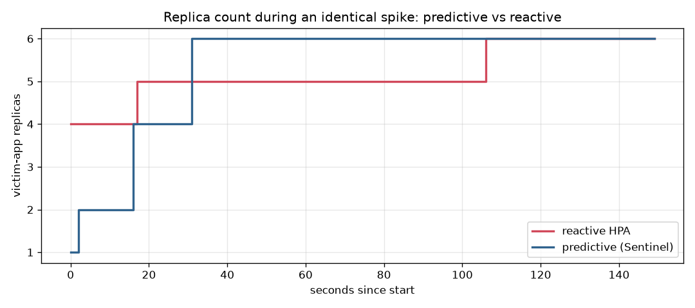

# Predictive vs Reactive

| metric | reactive | predictive |
|---|---|---|
| p95 latency (ms) | 80.7 | 45.9 |
| p99 latency (ms) | 434.2 | 127.7 |
| error rate | 0.06% | 0.04% |
| failed requests | 8 | 6 |
| total requests | 14177 | 14316 |

Reactive scales *after* CPU crosses the target; predictive raises minReplicas *before* the spike (see the earlier step in the chart).
